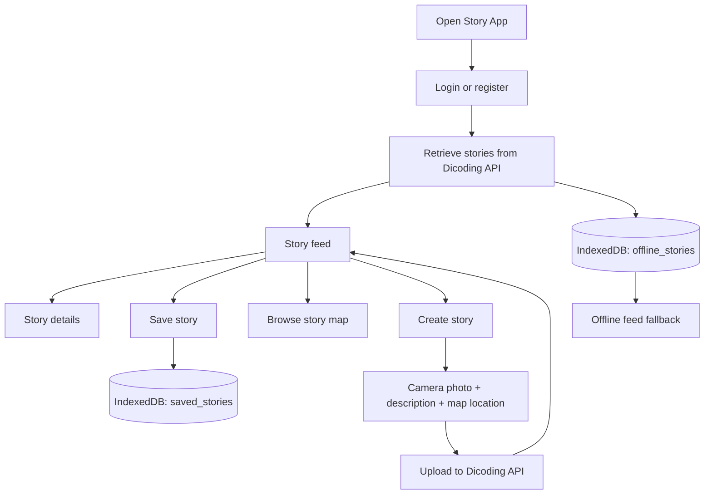
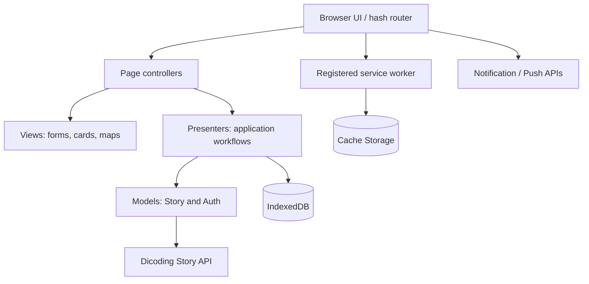

# Story App — Dicoding Story Sharing PWA Prototype

**A JavaScript single-page application for sharing photo stories, exploring their locations, bookmarking posts, and experimenting with offline-first browser capabilities.**

Story App is an educational web project developed for a Dicoding submission. It connects to the **Dicoding Story API** to register users, authenticate, retrieve photo stories, view story details, and upload new posts. Beyond the basic story-sharing flow, this version explores **IndexedDB local persistence**, **Workbox service-worker generation**, **browser notifications**, and **Leaflet maps**.

**Tech focus:** Vanilla JavaScript · Vite 6 · presenter/view separation · Dicoding Story API · IndexedDB (`idb`) · Leaflet · Workbox · Web Push APIs

> [!IMPORTANT]
> **Project status: learning project / PWA prototype.** The code contains offline caching and push-notification integration, but the production build, installability, background push delivery, and complete offline behavior have **not been verified** as part of this documentation audit. It is not a production social network.

## Why this project exists

Photo-sharing applications connect several browser capabilities: authenticated APIs, images, location, persistent local data, responsive UI, and occasionally offline access. This project brings those pieces into a small application for learning how they interact.

The core workflow is:

1. Create an account or log in through the Dicoding Story API.
2. Browse other users' stories and open their details.
3. Capture a photo with the browser camera and select a location on a map.
4. Submit the description, image, and coordinates to the Story API.
5. Save interesting stories in IndexedDB and revisit them from the **Saved Stories** page.
6. Explore cached story data when network access is unavailable, subject to the limitations below.

## Feature overview

| Feature | Implementation | Current scope |
| --- | --- | --- |
| Registration and login | Dicoding Story API, bearer token in `localStorage` | Implemented in source; requires external API |
| Story feed | Fetch stories, render cards, link to details | Implemented in source |
| Story detail | Author, photo, description, date, coordinates when available | Implemented in source |
| New story | Camera capture through `getUserMedia`, text description, Leaflet location picker, multipart upload | Implemented; browser/media/map integration needs verification |
| Maps | Leaflet and OpenStreetMap markers for stories with coordinates | Implemented in source |
| Saved stories | Save and remove individual stories through IndexedDB | Implemented in source |
| Offline story data | Sync retrieved feed data to IndexedDB and fall back to local records on errors/offline | Partial: requires previously fetched records; cached images not guaranteed |
| Service worker | Workbox `generateSW` build step and runtime cache configuration | Configured; generated-worker behavior unverified |
| Notifications | Browser permission, push-subscription flow, and local test notification | Partial: background push event integration is unverified |
| SPA navigation | Hash routing, navigation drawer, View Transitions API fallback | Implemented in source |
| PWA metadata | Web app manifest and local icon | Present; installation eligibility not verified |

**Not implemented as a complete product:** offline story creation/upload queue, account management, comments, direct messages, real-time chat, or server-side data storage owned by this repository.

## Routes and user flow

This is a **hash-routed** single-page application:

| Route | Purpose |
| --- | --- |
| `#/` | Story feed and bookmarks |
| `#/register` | Account registration |
| `#/login` | Account login |
| `#/detail/:id` | Story details |
| `#/add` | Add a photo story |
| `#/maps` | Map with story location markers |
| `#/saved` | Locally saved stories |
| `#/about` | About the project |
| Other routes | Not-found view |



### Publish a new story

The current add-story screen uses the **device camera**, a required description, and a clicked map location:

- The camera is requested with `navigator.mediaDevices.getUserMedia({ video: true })`.
- A captured frame is converted from a canvas into a JPEG blob.
- Leaflet provides a map point that becomes `lat` and `lon`.
- A presenter submits the photo and fields as multipart `FormData` to the Dicoding API.

**A selected map location is currently required by the presenter.** There is no gallery file-upload alternative on this screen, and the form does not implement offline queueing.

Camera access requires a supported browser, user permission, and usually HTTPS (localhost is permitted in supported development environments).

## Architecture

This is a **frontend-only** application with page modules, presenters, views, and API models; it does not include its own backend.



**Responsibilities**

- `src/scripts/pages/`: route-level page lifecycle.
- `src/scripts/views/`: render HTML, wire UI events, and display feedback.
- `src/scripts/presenters/`: coordinate workflows between views and models.
- `src/scripts/models/`: authenticated requests to the external Story API.
- `src/scripts/utils/idb.js`: IndexedDB storage and saved-story operations.
- `src/scripts/utils/story-sync.js`: synchronize fetched story lists and listen for worker messages.
- `src/scripts/utils/push.js`: Web Push subscription requests.
- `src/scripts/routes/`: map URL hashes to pages.

The architecture is inspired by a **Model–View–Presenter separation**, although state and DOM rendering still live in plain JavaScript objects.

## Data storage and offline behavior

### IndexedDB

The application opens an IndexedDB database named `story-app-db` at version `2`.

| Object store | Purpose |
| --- | --- |
| `offline_stories` | Stores fetched story records for offline fallback; refreshed when the online feed is synchronized |
| `saved_stories` | Stores manually bookmarked stories, with a local `savedAt` timestamp |

Both stores use the story `id` as the key and have a `createdAt` index.

The **Home** and **Maps** presenters attempt an API request and fall back to previously stored `offline_stories` if loading fails. The Saved Stories page reads `saved_stories`.

**Offline-first is not offline-complete.** First-time access still needs connectivity; images and map tiles depend on cache availability. Saving a story locally does not mean the server has received a new story. The app does not provide a background upload queue.

### Service workers and caching

The repository contains **several different service-worker sources**:

- `workbox-config.cjs` — used by the `workbox generateSW` build command to generate `dist/sw.js`.
- `src/sw.js` and `src/sw-base.js` — additional custom worker code checked into source.
- `public/sw.js` — another standalone service-worker implementation outside the configured Vite public directory.

The regular production script is:

```text
vite build
    ↓
dist/ assets
    ↓
workbox generateSW workbox-config.cjs
    ↓
dist/sw.js
```

The application registers `/sw.js` at runtime. **The `generateSW` pipeline does not automatically incorporate arbitrary event handlers written in the separate `src/sw.js` and `src/sw-base.js` files.** Consequently, the existence of custom `push` listeners in those files does not prove that the deployed/generated worker handles incoming push events.

The Workbox configuration specifies caching approaches for page navigation, scripts/styles, images, API responses, and external map resources. Those strategies are **configuration intent**, not evidence that all cached resources or offline paths work correctly in a deployed build.

### Push notifications

The code contains a VAPID public key, a request to subscribe using `PushManager`, and a request to the Dicoding notification-subscription endpoint. A separate **Test Notification** UI uses `ServiceWorkerRegistration.showNotification()`.

A successful local notification is **not the same** as confirming remote push delivery. The generated worker, API subscription, permission state, HTTPS configuration, and actual push event handler must all be validated together.

## Tech stack

| Area | Technology |
| --- | --- |
| Language | JavaScript, HTML, CSS |
| Build | Vite 6 |
| Architecture | Hash-based SPA with presenter/view modules |
| Network | Native Fetch API, Dicoding Story API |
| Interactive maps | Leaflet 1.9, OpenStreetMap tiles |
| Local persistence | IndexedDB via `idb` |
| Offline / PWA | Workbox CLI, Cache Storage, Web App Manifest |
| Notifications | Notification API, Push API, Service Worker |
| Dialogs | SweetAlert2 |
| Formatting | Prettier |

No React, Vue, Express, or database server is used in this repository.

## Getting started

### Requirements

- Node.js version compatible with **Vite 6** and npm.
- A modern browser.
- Internet access for the Dicoding Story API.
- Camera/location permission and a secure context for the relevant browser features.

### Clone and install

```bash
git clone https://github.com/alfrzhb/story-app-akhir.git
cd story-app-akhir
npm install
```

### Local development

```bash
npm run dev
```

Open the local address printed by Vite. The configured Vite root is `src/`, and static assets are served from `src/public/`.

For story requests, the main `StoryModel` and `AuthModel` call `https://story-api.dicoding.dev/v1` directly. Another file, `src/scripts/data/api.js`, uses `/api` in development or `VITE_API_BASE_URL` in production, **but it is not the API adapter used by the principal presenter/model flows**. Do not assume setting `VITE_API_BASE_URL` redirects every API call.

> **Development service-worker caveat:** the application attempts to register `/sw.js`, while the production service worker is generated by Workbox during `npm run build`. A missing development worker is possible; PWA behavior should be tested against a built preview, not inferred from the Vite dev server.

### Production build and preview

```bash
npm run build
npm run preview
```

The build script first runs Vite and then generates a Workbox service worker. Output is configured for `dist/` at the repository root.

If the Workbox step fails, inspect `workbox-config.cjs` and ensure the service-worker file being tested is the one actually produced in `dist/`. This documentation update has **not** executed or validated the build pipeline.

### Formatting scripts

```bash
npm run format
npm run format:check
```

There is **no configured automated `test` or `lint` script** in `package.json`.

## Repository layout

```text
story-app-akhir/
├── README.md                     # Project documentation
├── STUDENT.txt                   # Submission metadata / listed app URL
├── package.json                  # Vite, idb, Leaflet, Workbox, Prettier
├── vite.config.js                # Vite root: src; output: dist
├── workbox-config.cjs            # Production generateSW configuration
├── public/
│   ├── manifest.json             # Alternate manifest in repository
│   └── sw.js                     # Alternate service-worker implementation
└── src/
    ├── index.html                # SPA HTML shell
    ├── public/
    │   ├── manifest.json         # Manifest used by Vite's publicDir
    │   └── images/               # App icon and branding
    ├── scripts/
    │   ├── index.js              # Startup, navigation, worker, notifications
    │   ├── config.js             # External API base configuration
    │   ├── data/api.js           # Secondary API helper
    │   ├── models/               # Auth and Story API models
    │   ├── pages/                # Hash-route page wrappers
    │   ├── presenters/           # Home, maps, add, auth, saved stories
    │   ├── views/                # HTML templates and UI handlers
    │   ├── routes/               # Route map and URL parser
    │   └── utils/
    │       ├── idb.js            # Saved and cached stories
    │       ├── story-sync.js     # Feed sync and worker messages
    │       ├── push.js           # Subscription logic
    │       ├── auth.js           # Logout handling
    │       └── location.js       # Coordinates display helper
    ├── styles/
    │   └── styles.css
    ├── sw.js                     # Custom SW source; not automatically merged
    └── sw-base.js                # Additional custom SW source
```

## Current limitations and known integration risks

The following are observations from source review, not results of a runtime testing session.

1. **Service-worker source ambiguity.** Multiple worker files coexist, while the production build uses Workbox `generateSW`. Audit the generated `dist/sw.js` and consolidate to one worker pipeline before claiming background push delivery or reliable offline navigation.
2. **Add-story map dependency.** `AddStoryView` uses a global `L` identifier without importing Leaflet; `MapsView` imports Leaflet as a module, which does not necessarily expose `L` globally. The location picker may fail unless the runtime supplies that global.
3. **PWA manifest mismatch.** `src/public/manifest.json` has a shortcut targeting `/#/add-story`, but the actual add-story route is `#/add`. An alternate `public/manifest.json` also exists outside the configured Vite public directory.
4. **Offline data is conditional.** IndexedDB only helps after online data has been fetched/saved; image and map cache coverage is not assured.
5. **Local data cleanup is inconsistent.** `clearBrowserData()` exists in the startup module but is not wired to the Home page's **Hapus Data Offline** button. Do not assume clicking that button clears storage.
6. **Browser token storage.** Login tokens are saved in `localStorage`. API responses are also considered by caching strategies. Review storage isolation, session logout behavior, and API cache security before production use.
7. **Dynamic HTML injection risk.** Story names/descriptions and other external content are interpolated into `innerHTML` and map popups. Escape or sanitize untrusted text to mitigate cross-site scripting.
8. **Event lifecycle and map cleanup.** Some presenters attach global `online`/`offline` event handlers on initialization, and maps are created as new Leaflet instances; navigational cleanup is not consistently shown.
9. **No automated functional tests.** There is no test suite configured by `package.json` for routing, API errors, IndexedDB migrations, camera permissions, or push subscriptions.
10. **No confirmed production readiness.** This audit did not verify a successful build, service-worker installation, offline session, push subscription, or end-to-end upload.

### Suggested improvement order

- **P0:** Consolidate service workers, verify production `npm run build`, and confirm the correct production registration target.
- **P0:** Fix the Leaflet import in the add-story screen and make external story content safe for DOM rendering.
- **P1:** Fix manifest shortcuts, clean up IndexedDB controls, and test offline navigation/images.
- **P1:** Add reproducible tests for login, feed, bookmarking, upload, and error states.
- **P2:** Add camera fallback/upload selection, accessibility testing, and documentation of validated deployment.

## Relationship to other Story App repositories

There are separate Story App implementations within this GitHub account:

- [`story-app`](https://github.com/alfrzhb/story-app) — browser-based Dicoding Story SPA using Vanilla JavaScript, Vite, Leaflet, and presenter/view-style separation.
- [`notes-app`](https://github.com/alfrzhb/notes-app) — historically named `notes-app`, but its source implements another Dicoding Story web/PWA project.
- [`StoryApp`](https://github.com/alfrzhb/StoryApp) — **native Kotlin Android** Story App with Android-specific architecture and APIs.
- **`story-app-akhir` (this repository)** — JavaScript Story App variation with IndexedDB saved/offline stories, Workbox configuration, and push-notification exploration.

These should be treated as **distinct repositories/iterations**, not automatically assumed to be integrated or backed by the same deployments.

## Deployment and license

The repository includes an application URL in `STUDENT.txt`:

- **Listed submission URL:** https://storyappfariz.netlify.app/

That address is included as **repository-provided metadata**; its current availability and functional correctness were **not independently checked** in this audit.

After validating the build, the generated `dist/` directory can be deployed to a static web host. Validate the root-relative manifest paths, service-worker scope, HTTPS, notification permission, and offline behavior on the deployed origin.

No root `LICENSE` file was found in the inspected repository tree. Do not infer a specific open-source license.

## Acknowledgements

- [Dicoding Indonesia](https://www.dicoding.com/) for the learning context and Story API.
- [Leaflet](https://leafletjs.com/) and [OpenStreetMap](https://www.openstreetmap.org/) for location visualization.
- [Workbox](https://developer.chrome.com/docs/workbox/) for service-worker generation and cache strategies.

---

Maintained at **[alfrzhb/story-app-akhir](https://github.com/alfrzhb/story-app-akhir)**. This README documents **source-code capabilities and observed limitations**, not an independently verified production build.
